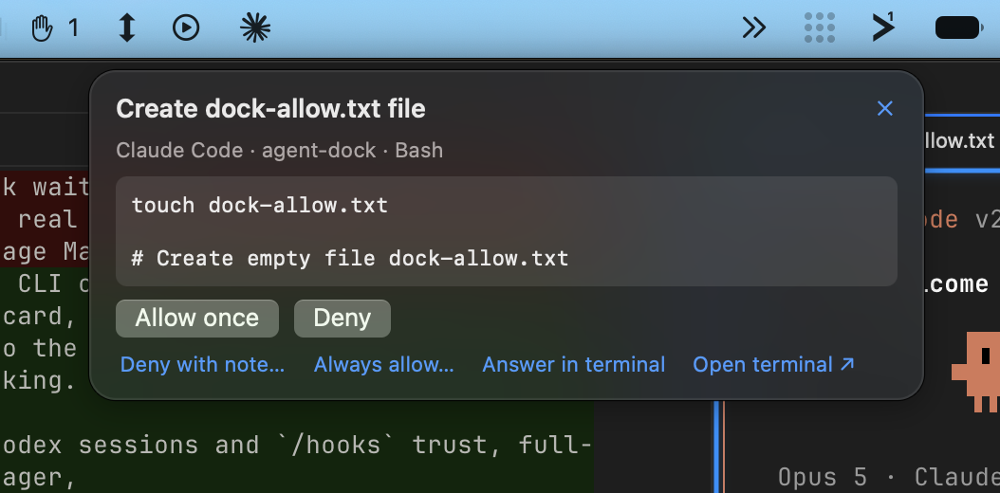

# Agent Dock

A small macOS menu-bar app that brings Claude Code and Codex permission prompts to you, so you
don't have to find the right Terminal tab, window or Space. A drop-down shows up at the top of the
screen without taking focus. You click **Allow once** or **Deny**, and the answer goes back to the
exact session that's waiting.

<p align="center">
  
</p>

- Local only. A per-user Unix socket (mode 0600, inside a 0700 folder). No network, no analytics.
- Fails safe. If Agent Dock isn't running, crashes, or you don't answer within 45 s, the hook
  returns *no decision* and the agent shows its own prompt as usual. Nothing is ever allowed
  automatically.
- Dismissing or hiding the panel never answers a request. Only **Allow** or **Deny** do.

## Install (macOS)

You need [uv](https://docs.astral.sh/uv/). If it's missing, the installer prints the command to
install it.

```bash
git clone <this repo> && cd agent-dock
./scripts/install
```

This:

1. Creates a private Python environment in `~/Library/Application Support/AgentDock/venv` and
   installs a copy of this checkout into it. Moving or deleting the repo afterwards is fine.
2. Adds one `PermissionRequest` hook entry to `~/.claude/settings.json` and to
   `~/.codex/hooks.json`. Your other settings and hooks are kept, and the original files are backed
   up to `~/Library/Application Support/AgentDock/backups/` first.
3. Installs and starts a login LaunchAgent (`~/Library/LaunchAgents/local.agent-dock.plist`).

**Codex only:** start Codex, run `/hooks`, and trust the Agent Dock hook. Codex skips untrusted
hooks.

Options: `./scripts/install --no-codex`, `--no-claude`, `--no-launch-agent`.

## Try it

```bash
APP="$HOME/Library/Application Support/AgentDock/venv/bin/python"
"$APP" -m agent_dock doctor          # checks install, broker, hooks, LaunchAgent
"$APP" -m agent_dock simulate        # sends 3 fake requests through the real hook
"$APP" -m agent_dock simulate --command "npm run build" --suggest
```

Then run Claude Code normally, without bypass mode, and ask it for something that needs
permission.

What you should see:

| When | Behaviour |
|---|---|
| A request arrives | The panel drops down expanded, without stealing focus or switching Spaces |
| After 10 s | It shrinks to one line: “Title · needs approval” |
| After 30 s | It hides. The menu-bar badge still counts what's waiting |
| You hover | It expands again, then shrinks back 1 s after the pointer leaves |
| You click ✕ | It hides but doesn't answer. The request stays in the inbox |
| You click the menu-bar icon | The inbox opens and lists every waiting request. Esc or a click elsewhere closes it |
| You right-click the menu-bar icon | Open inbox / Hide panel / Quit |

Extra actions on each card:

- **Deny with note…** sends your reason to the agent.
- **Always allow…** (Claude only) appears only when Claude itself proposed a rule. It shows the
  exact rule and where it will be stored.
- **Answer in terminal** hands the request back to the agent's own prompt.
- **Open terminal ↗** brings the terminal app that's running the agent to the front.

## Uninstall

```bash
./scripts/uninstall            # removes only Agent Dock's hook entries and the LaunchAgent
./scripts/uninstall --purge    # also deletes the venv and runtime folder (backups and settings are kept)
```

## Settings

Edit `~/Library/Application Support/AgentDock/settings.json` (it's created only when you save one):

```json
{
  "request_timeout_seconds": 45,
  "expanded_seconds": 10,
  "visible_seconds": 30,
  "hover_leave_seconds": 1,
  "display": "active",
  "badge_only": false,
  "sensitive_mode": false,
  "passthrough_tools": ["AskUserQuestion"]
}
```

`display` can be `active` (the screen with the focused window), `mouse` or `primary`. If you change
`request_timeout_seconds`, run `./scripts/install` again so the hook timeout written into the agent
config stays above it.

## Logs and troubleshooting

- App log: `~/Library/Logs/AgentDock/`. Commands and tool inputs are never logged; only request
  IDs, agent and tool names are.
- If the hook seems to do nothing, run it by hand:
  `AGENT_DOCK_HOOK_DEBUG=1 "$APP" -m agent_dock.hook claude < some-request.json`
- Restart the app: `launchctl kickstart -k gui/$(id -u)/local.agent-dock`
- Run it in the foreground with verbose logs:
  `launchctl bootout gui/$(id -u)/local.agent-dock; "$APP" -m agent_dock run -v`

## Development

```bash
uv sync
uv run pytest                          # unit + integration (real socket, real hook subprocesses)
uv run ruff check . && uv run ruff format --check .
uv run python -m agent_dock run --console --demo   # terminal UI; works on Linux
```

Layout: `core/` (models, session titles), `broker/` (socket server and request registry),
`adapters/` (Claude and Codex JSON), `hook.py` (the agent-side client), `ui/` (state machine,
view-model and AppKit), `install/` (merging hooks into config, LaunchAgent).

See `agent-dock-plan.html` for the design and `docs/compatibility.md` for verified agent behaviour.

## Known limitations

- Agents running inside Docker or Linux sandboxes can't reach the host socket. That needs the
  container bridge, which is deferred.
- Full-screen apps and Stage Manager: whether the panel appears there still needs testing on real
  hardware.
- Claude's `AskUserQuestion` always goes to the native UI. Answering it from the dock needs a
  dedicated form.
- Claude doesn't run PermissionRequest hooks for network requests from sandboxed commands, so those
  prompts still appear only in the terminal.
